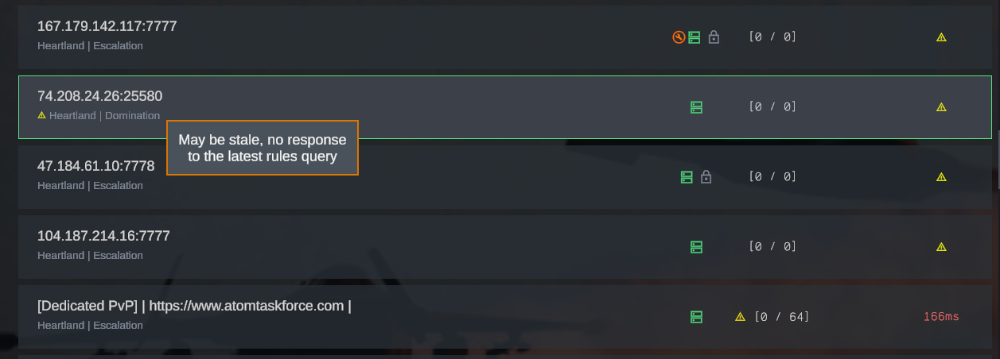
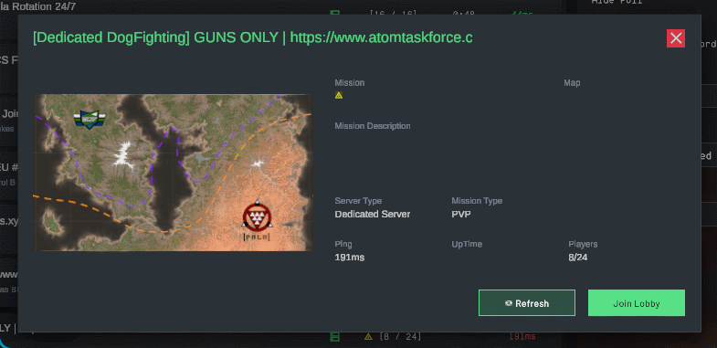

# Multiplayer Lobby Fixes

A mod that improves the server list and fixes all known to me issues with Steam joins.




## Changes

Many of those things have configurations if you have BepInEx config manager installed.

Please note that most of the changes only apply to *dedicated servers*, as that's where the issues were.

- A dedicated server whose query port does not answer this machine is listed anyway, from the copy Steam's master list handed over, instead of vanishing with a line in the log. Such servers are often reachable through Steam even when a direct query fails.
- If a server entry receives a proper piece of info, a bogus piece of info won't replace it anymore.
- Added a per-server **`🔃 Refresh` button** in the details window, same as main refresh but per-server.
- Added markers of server state, on the list and in the details window:
  - 🔃 while that one server is being asked about, or while its rules query is out,
  - ⚠️ for a server the master list could not reach (ping column) and for a rules query that came back empty (mission cell), with a clarification in a tooltip,
  - nothing for fresh info.
- Rules query failures don't stop from joining the server anymore when you in fact could join.
- The `Join` button is not grayed out anymore to be able to join to "0/0" servers (the legit full server will refuse a join anyway).
- `Join Game` from Steam (and CLI) now properly works in all cases:
  - the redundant queries/checks were removed or are skipped if they do some miniscule use, actually joining the game is the first priority, which makes it work for servers better,
  - the queries are made twice because for some reason the first queries are usually refused by Steam,
  - fixed `Join Game` not working from desktop because of `+join_lobby` being passed instead of `-joinLobby`,
  - implemented `Join Game` support from when you're already in Nuclear Option (the game had no handling for this whatsoever apparently), with full "leave current screen safely" handling by the game;
- A join that fails outside the server browser (a Steam invite, the launch argument) now shows why, "Server full" and the rest, instead of leaving the join overlay at "Connecting via Steam"; the game shows those reasons only from inside the browser.
  - A join whose lobby data Steam never sends is given up on with the game's own "Lobby no longer exists or Steam is unavailable", not waited on forever.

## Download and install

Needs BepInEx 5 x64 in the game directory.

1. Take the archive from a release, or [build it](#build) yourself.
2. Unzip it and put the `MultiplayerLobbyFixes` folder into `Nuclear Option\BepInEx\plugins\`.
3. Start the game. The mod writes its config to `BepInEx\config\com.kerbiter.multiplayerlobbyfixes.cfg`.

The archive holds the DLL, the readme and the licence. NOMM entry pending, so for now the folder goes in by hand as above.

Every setting is documented in that file and in the Configuration Manager window (F1) while the game runs. [The full list](docs/configuration.md).

Why each of these behaves the way it does, and what vanilla does in the same place, is in the [technical notes](docs/technical-notes.md).

## Build

```powershell
dotnet build src\MultiplayerLobbyFixes\MultiplayerLobbyFixes.csproj -p:NuclearOptionRoot="D:\path\to\Nuclear Option"
```

The build resolves the game path from `-p:NuclearOptionRoot` first, then `Directory.Build.user.props`, then the `NUCLEAR_OPTION_ROOT` variable, and stops with an explanation rather than guessing. It copies the DLL into the game unless you pass `-p:DeployToPlugins=false`. Copy `Directory.Build.user.props.example` to get started. The rest, including the launch config and how to tell which build the game loaded, is in the [technical notes](docs/technical-notes.md#build-and-launch).

## Disclaimers

### AI usage

This mod is authored by an experienced software engineer, but by vibecoding as an experiment. Treat it as pre-release, because the code has only been partially reviewed manually (but is tested to the extent of my imagination). It is published in the hope that it is useful, but as is and without warranties.

### Fair usage disclaimer

This mod doesn't aim to circumvent any protections or harm any player or service. By default queries are throttled in hopes of reducing rate limiting and to not hammer anything.

## Acknowledgements

- **erjet** - help testing the Steam game joins
- **Moroznik** - help testing the Steam game joins
- **[Appulcake](https://github.com/Appulcake)** (Maelle) - 0.1.0 review and detailed dev feedback

## Licence

GPL-3.0. See [LICENSE](LICENSE). Copyright (C) 2026 Metadorius.

GPL-3.0 wants the source to travel with the binary, and this repository is that source for every release.

*This project is an unofficial community modification and is not affiliated with, sponsored by, or endorsed by Shockfront Studios Pty Ltd. Original Nuclear Option assets, vehicle designs, audio, and code are Copyright (c) 2026 Shockfront Studios Pty Ltd. All rights reserved. Nuclear Option and Shockfront Studios are trademarks or registered trademarks of Shockfront Studios Pty Ltd. Original mod content and all other trademarks belong to their respective owners.*
