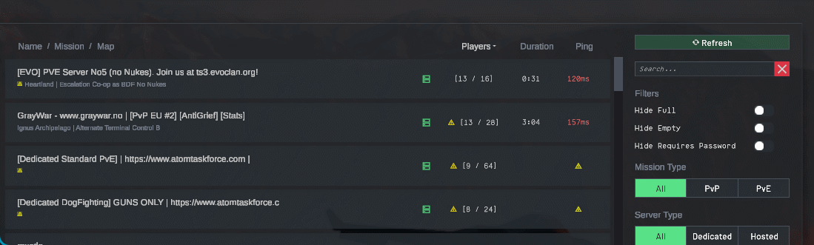
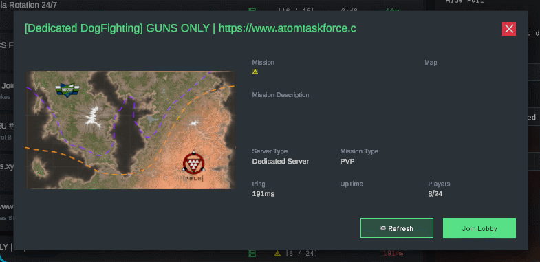

# Multiplayer Lobby Fixes

A mod that fixes the server list (best-effort until devs fix it for real), overhauls it and the filter list, and fixes all known to me issues with Steam joins.




## Changes

Many of those things have configurations if you have BepInEx config manager installed.

Please note that most of the changes only apply to *dedicated servers*, as that's where the issues were.

### Changes

- The server browser now shows the dedicated servers ASAP regardless of whether the game/Steam thinks they're reachable (cause they frequently are despite queries not going through).
  - The servers which were not reached are not re-pinged automatically to save queries.
- Nothing clears the server list anymore (because Steam quickly stops returning you the server list because of rate limit or w/e), including `🔃 Refresh` button, which now just appends/amends (if the entry has legit info) the server entries.
  - A refresh makes all the servers in the list refresh regardless if they came in an answer.
  - The servers survive leaving the multiplayer screen and coming back, too.
- If a server entry receives proper piece of info (name, player count, etc), a bogus piece of info (0/0 player count) won't ever replace it anymore.
- Added a per-server **`🔃 Refresh` button** in the detailed server info.
- Added markers of state of the per-server data:
  - 3 states:
    - ⚠️ icon for possibly stale information (request wasn't answered, or answered with nothing usable), with a clarification in a tooltip,
    - animated 🔃 icon for a query in progress;
    - no icon - fresh info
  - shown in:
    - server list
    - detailed info card
  - shown for (currently omitting master list request), besides the text:
    - server rules query (in mission field)
    - server status query (in ping field)
- The `Join` button is not grayed out anymore to be able to join to "0/0" servers (the legit full server will refuse a join anyway).
- Filters are now fully local and never requery.
- Queries are throttled by default to not hammer the servers or Steam.
  - When enabled, one query per frame max. is going out, 0ms delay corresponds to that.
  - 5ms is the default minimal cooldown.
- Servers listed because Steam's master list could not reach them are held out of the game's ping loop, which would otherwise ask those silent hosts again on every pass and hold a socket per attempt until the client's socket set runs out and later refreshes come back nearly empty; one of them answering anything, or a master list that reaches it, puts it back in the loop.
- `Join Game` from Steam (and CLI) now properly works in all cases:
  - the redundant queries/checks were removed or are skipped if they do some miniscule use (in future may be skipped completely), actually joining the game is the first priority, which makes it work for servers better,
  - the queries (both joining player and server lobbies) are made twice because for some reason the first queries are usually refused by Steam,
  - fixed `Join Game` not working from desktop because of `+join_lobby` being passed instead of `-joinLobby` (unsure if some mod issue or vanilla),
  - implemented `Join Game` support from when you're already in Nuclear Option (the game had no handling for this whatsoever apparently), with full "leave current screen safely" handling by the game;
- A join that fails outside the server browser (a Steam invite, the launch argument) now shows why, "Server full" and the rest, instead of leaving the join overlay at "Connecting via Steam"; the game shows those reasons only from inside the browser.
  - A join whose lobby data Steam never sends is given up on with the game's own "Lobby no longer exists or Steam is unavailable", not waited on forever.
- Ping queries no longer discard every other status info piece (like current player count) and properly update them.
- Changed lobby info now doesn't get stuck on the same position and is sorted correctly.

## Known issues

Sometimes the console can spam `count < FD_SETSIZE` lines while refreshing. They should stop on their own.

## Download and install

Needs BepInEx 5 x64 in the game directory.

1. Take the archive from a release, or [build it](#build) yourself.
2. Unzip it and put the `MultiplayerLobbyFixes` folder into `Nuclear Option\BepInEx\plugins\`.
3. Start the game. The mod writes its config to `BepInEx\config\com.kerbiter.multiplayerlobbyfixes.cfg`.

The archive holds the DLL, the readme and the licence. NOMM entry pending, so for now the folder goes in by hand as above.

Every setting is documented in that file and in the Configuration Manager window (F1) while the game runs. [The full list](docs/configuration.md).

Why each of these behaves the way it does, and what vanilla does in the same place, is in the [technical notes](docs/technical-notes.md).

## Build

```powershell
dotnet build src\MultiplayerLobbyFixes\MultiplayerLobbyFixes.csproj -p:NuclearOptionRoot="D:\path\to\Nuclear Option"
```

The build resolves the game path from `-p:NuclearOptionRoot` first, then `Directory.Build.user.props`, then the `NUCLEAR_OPTION_ROOT` variable, and stops with an explanation rather than guessing. It copies the DLL into the game unless you pass `-p:DeployToPlugins=false`. Copy `Directory.Build.user.props.example` to get started. The rest, including the launch config and how to tell which build the game loaded, is in the [technical notes](docs/technical-notes.md#build-and-launch).

## Disclaimers

### AI usage

This mod is authored by an experienced software engineer, but by vibecoding as an experiment. Treat it as pre-release, because the code has only been partially reviewed manually (but is tested to the extent of my imagination). It is published in the hope that it is useful, but as is and without warranties.

### Fair usage disclaimer

This mod doesn't aim to circumvent any protections or harm any player or service. By default queries are throttled in hopes of reducing rate limiting and to not hammer anything.

## Acknowledgements

- **erjet** - help testing the Steam game joins
- **Moroznik** - help testing the Steam game joins

## Licence

GPL-3.0. See [LICENSE](LICENSE). Copyright (C) 2026 Metadorius.

GPL-3.0 wants the source to travel with the binary, and this repository is that source for every release.

*This project is an unofficial community modification and is not affiliated with, sponsored by, or endorsed by Shockfront Studios Pty Ltd. Original Nuclear Option assets, vehicle designs, audio, and code are Copyright (c) 2026 Shockfront Studios Pty Ltd. All rights reserved. Nuclear Option and Shockfront Studios are trademarks or registered trademarks of Shockfront Studios Pty Ltd. Original mod content and all other trademarks belong to their respective owners.*
